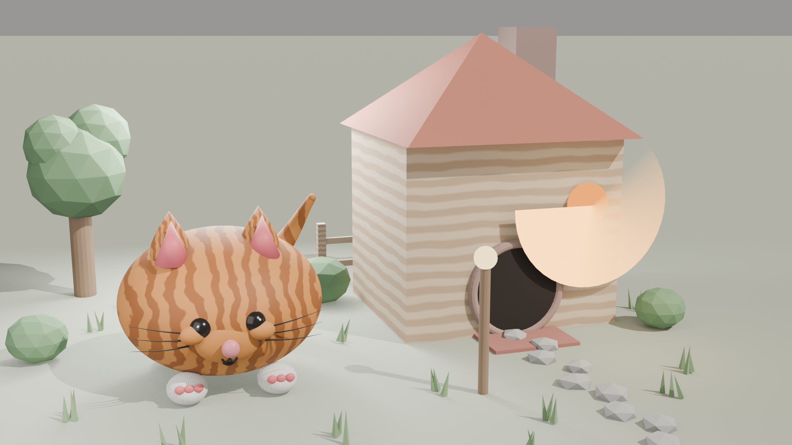
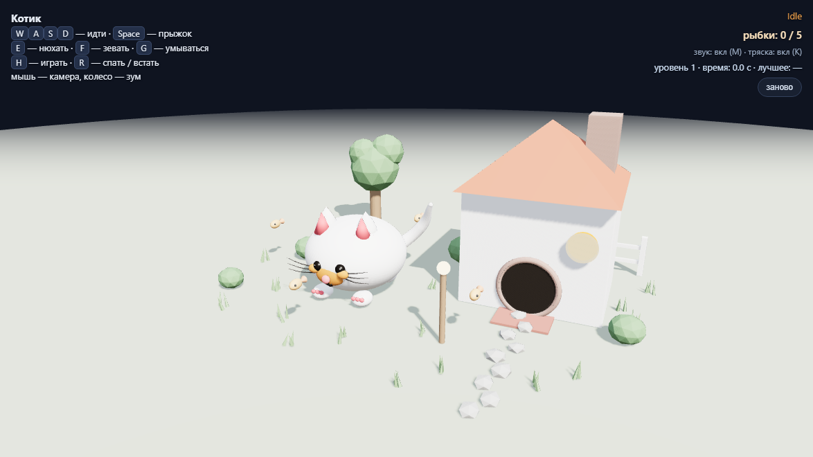

# Котик

3D-сцена с котом, домиком и двором: 15-костный риг, девять анимаций, экспорт в GLB — собрано в Blender 5.2 и вынесено в браузер без единой внешней зависимости.

**[Играть](https://0x888-q.github.io/kotik/)** · **[Смотреть клипы](https://0x888-q.github.io/kotik/viewer.html)**

## Игра

Кот ходит по двору и собирает рыбок: пять штук — и начинается следующий уровень, счёт и время видны на экране, рекорд держится до перезагрузки. Камера вращается мышью, звук синтезируется в браузере через WebAudio, тач-управление работает на телефоне.

| Клавиша | Действие |
|---|---|
| `W` `A` `S` `D` | идти |
| `Space` | прыжок |
| `E` | нюхать |
| `F` | зевать |
| `G` | умываться |
| `H` | играть |
| `R` | спать / встать |
| мышь, колесо | камера, зум |
| `M` | звук вкл/выкл |
| `K` | тряска камеры вкл/выкл |

Сбор рыбки отзывается сразу несколькими каналами: кольцо-вспышка на месте рыбки, короткий hit-stop (60 мс замедления мира), тряска камеры на затухающем trauma, пульс счётчика в HUD и звуковой аккорд. Приземление и прыжок дают squash & stretch на узле кота. Тряска отключается клавишей `K`, а если в системе включено «уменьшение движения», игра стартует с выключенной тряской.

## Клипы

Просмотрщик переключает девять NLA-клипов сцены: `Idle` 6.04 с, `Sleep` 4.04 с, `Wash` 3.0 с, `Play` 2.5 с, `Walk` 2.04 с, `Hop`, `Yawn`, `Stretch` по 2.0 с, `Sniff` 1.5 с.

## Как сделано

Вся сцена построена скриптами Blender 5.2.3 в headless-режиме: геометрия кота, дом, забор, дерево, фонарь и окружение — процедурно, затем риг из 15 костей (`root`, `body`, `ear.L/R`, `eye.L/R`, `jaw`, `nose`, `tail.1-3`, `paw.F/B.L/R`) и девять клипов через NLA.

Перед экспортом сцена оптимизирована: 143 объекта сведены в 73, трава, камни и кусты схлопнуты в единые меши, три пары дублирующихся материалов объединены. Разница до/после — 9 пикселей из 921 600 при контрольном рендере.

GLB проверен на связность: 75 узлов, 59 мешей, 21 материал, все каналы анимаций указывают на существующие узлы, скин с 15 джойнтами. FBX проходит round-trip в чистую сцену без ошибок.

## Файлы

| Файл | Что это |
|---|---|
| `index.html` | игра, three.js вкомпилирован внутрь |
| `viewer.html` | просмотрщик клипов |
| `model/kotik-scene.glb` | сцена с девятью анимациями, 929 КБ |
| `model/mouse.glb` | мышь — второй персонаж сцены |

Страницы автономны: их можно открыть двойным щелчком с диска, сеть не нужна.

## Ограничения

- Хвост гнётся костями без скиннинга — выглядит жёстко, это самый заметный запас качества.
- Часть объектов окружения несёт собственные копии материалов.

## Лицензия

Модель, анимации и код — [0X888-Q](https://github.com/0X888-Q). three.js распространяется по лицензии MIT.