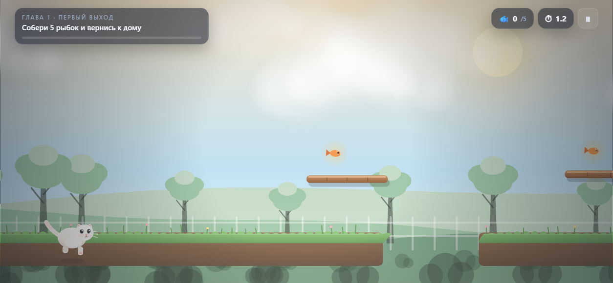

# Котик 2D

Пять коротких глав о коте, который идёт за рыбками: двор, лес, крыши на закате, ночь и ливень. Полностью нарисовано кодом — ни одного внешнего файла, картинки и звук создаются в браузере.

**[Играть](https://0x888-q.github.io/kotik/)** · **[3D-версия](https://0x888-q.github.io/kotik/3d.html)** · **[Клипы из Blender](https://0x888-q.github.io/kotik/viewer.html)**

## Главы

| Глава | Мир | Миссия |
|---|---|---|
| 1 | Двор, утро | Собрать 5 рыбок и вернуться к дому |
| 2 | Лес, листопад | Найти мышку и проводить её к двери |
| 3 | Крыши, закат | 7 рыбок на черепице, не задев ворон |
| 4 | Ночь | 9 светлячков в темноте, свет — только от фонарей и кота |
| 5 | Ливень | 12 рыбок за 90 секунд, лужи замедляют |

## Управление

| Клавиша | Действие |
|---|---|
| `A` `D` или `←` `→` | идти |
| `Space` | прыжок (короткое нажатие — низкий) |
| `Esc` | пауза |
| `M` | звук |
| на телефоне | кнопки внизу экрана |

## Что внутри

- **Векторный кот** нарисован путями: дыхание, шаг с четырьмя лапами, виляние хвостом, мигание, уши, squash & stretch на прыжке и приземлении, наклон в воздухе.
- **Пять тем** с собственным небом, параллаксом в четыре слоя, солнцем или луной, облаками на спрайтах, домами, деревьями и кустами.
- **Погода**: листопад в лесу, дождь со каплями и лужами, ночная тьма с прорезями света вокруг фонарей, светлячков и кота.
- **Физика платформера**: coyote time 0.1 с, буфер прыжка 0.12 с, короткий прыжок при отпускании, ускорение и трение, одноразовые доски, движущиеся платформы в третьей главе.
- **Сочность**: тряска камеры на затухающем trauma, пыль при беге и приземлении, искры на сборе, плавная камера с упреждением по скорости, вспышка HUD, тосты подсказок.
- **Прогресс**: три звезды за главу (все рыбки и время не хуже нормы), рекорд времени, открытие глав, сохранение в localStorage.
- **Звук**: синтез через WebAudio — пентатонический луп, шаги, прыжок, сбор, мяуканье, аккорд победы. Отключается в настройках.

## Настройки

Звук, тряска камеры и качество (количество частиц и слоёв). Если в системе включено «уменьшение движения», тряска стартует выключенной. Есть сброс прогресса.

## Файлы

| Файл | Что это |
|---|---|
| `index.html` | эта игра, один файл без зависимостей |
| `3d.html` | прежняя 3D-версия на three.js: сцена из Blender, 9 анимаций |
| `viewer.html` | просмотрщик клипов |
| `model/kotik-scene.glb` | сцена из Blender: 15 костей, 9 анимаций, 929 КБ |
| `model/mouse.glb` | мышь — второй персонаж |

## Как это сделано

Игра — один HTML-файл: Canvas 2D, никаких библиотек. Мир собирается из данных: платформы, рыбки, вороны, фонари и лужи описаны массивами, темы — палитрами. Кот рисуется векторно каждый кадр, фон — процедурно из детерминированного шума, поэтому уровень выглядит одинаково при каждом запуске.

Проверки: headless Edge прогоняет загрузку, ходьбу, прыжок, сбор рыбок, сопровождение мыши, таймер и финиш; ошибок в консоли нет.

## Лицензия

Код и графика — [0X888-Q](https://github.com/0X888-Q). three.js в 3D-версии распространяется по лицензии MIT.
